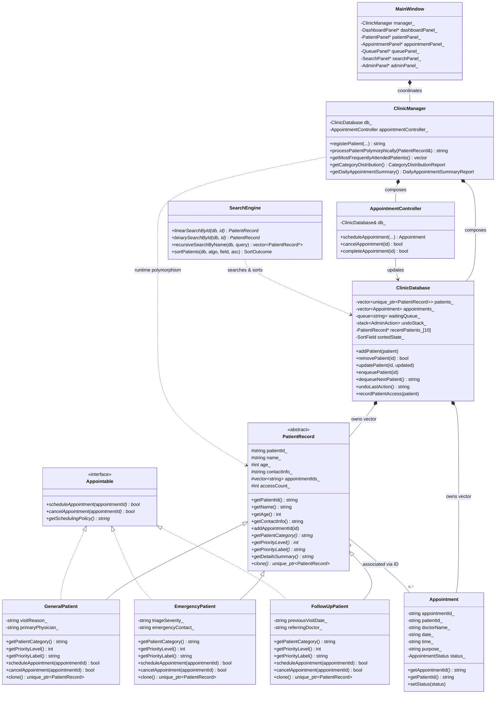

# SCAPMS — UML Class Diagram

The diagram below illustrates the object-oriented architecture of the **Smart Clinic Appointment & Patient Management System (SCAPMS)**, highlighting:
- **Abstract Classes:** `PatientRecord` and `Appointable`
- **Inheritance & Interface Realization:** `GeneralPatient`, `EmergencyPatient`, and `FollowUpPatient`
- **Runtime Polymorphism:** `ClinicManager::processPatientPolymorphically(const PatientRecord&)` and `ClinicDatabase` polymorphic container
- **Composition & Association:** `ClinicDatabase` owning `PatientRecord` and `Appointment` collections, `ClinicManager` coordinating controllers, and `MainWindow` hosting GUI panels.

